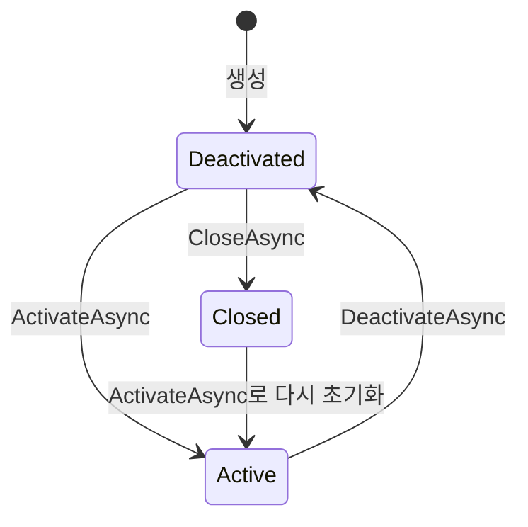

#  Stylet.MvvmToolkit

[Stylet](https://github.com/canton7/Stylet)을 기반으로, 화면 관리 기능을 유지하면서 구조와 사용 방식을 단순화하는 포크입니다.

## 사용 문서

[한국어 사용 가이드와 전체 목차](https://github.com/dragonfavors/Stylet.MvvmToolkit/wiki)에서 현재 구현에 맞는 설명과 예제를 확인할 수 있습니다.

- [빠른 시작](https://github.com/dragonfavors/Stylet.MvvmToolkit/wiki/Quick-Start) · [커스텀 Main](https://github.com/dragonfavors/Stylet.MvvmToolkit/wiki/Custom-Main) · [호스트와 DI](https://github.com/dragonfavors/Stylet.MvvmToolkit/wiki/Hosting-and-DI)
- [화면 생명주기](https://github.com/dragonfavors/Stylet.MvvmToolkit/wiki/Screens) · [화면 전환과 탭](https://github.com/dragonfavors/Stylet.MvvmToolkit/wiki/Conductors) · [View 연결](https://github.com/dragonfavors/Stylet.MvvmToolkit/wiki/ViewManager)
- [창·대화상자](https://github.com/dragonfavors/Stylet.MvvmToolkit/wiki/Windows-and-Dialogs) · [Toolkit](https://github.com/dragonfavors/Stylet.MvvmToolkit/wiki/MVVM-Toolkit) · [입력 검증](https://github.com/dragonfavors/Stylet.MvvmToolkit/wiki/Validation)
- [메시징](https://github.com/dragonfavors/Stylet.MvvmToolkit/wiki/Messaging) · [스레드·컬렉션](https://github.com/dragonfavors/Stylet.MvvmToolkit/wiki/Threading-and-Collections) · [기타 도구](https://github.com/dragonfavors/Stylet.MvvmToolkit/wiki/Utilities)
- [원본에서 이전](https://github.com/dragonfavors/Stylet.MvvmToolkit/wiki/Migration) · [문제 해결·샘플](https://github.com/dragonfavors/Stylet.MvvmToolkit/wiki/Troubleshooting)

## 원본 Stylet

Stylet은 Antony Male이 만든 WPF용 ViewModel 중심 MVVM 프레임워크입니다. Caliburn.Micro에서 영향을 받았으며, 테스트와 확장이 쉬운 애플리케이션을 만드는 것을 목표로 합니다.

주요 기능은 다음과 같습니다.

- `Screen`: 화면의 활성화·비활성화·종료와 수명주기 관리
- `Conductor`: 여러 화면의 관리와 탐색
- `ViewManager`, `View.Model`: ViewModel에 대응하는 View 탐색·생성·연결
- `WindowManager`: 창, 대화상자, 메시지 박스 표시
- 속성 변경 알림, 데이터 검증, 메시징, 자체 IoC 컨테이너
- XAML Action을 통한 ViewModel 메서드 호출

원본 자료:

- [소스 코드](https://github.com/canton7/Stylet)
- [문서 및 사용 방법](https://github.com/canton7/Stylet/wiki)
- [NuGet 패키지](https://www.nuget.org/packages/Stylet/)

## 이 저장소의 방향

**기존 화면 관리 기능을 유지하고, 프레임워크의 책임과 사용 방식을 단순화합니다.**

그 첫 단계로 XAML Action 계열과 `View.ActionTarget`을 제거했습니다. 메서드 이름을 해석하고 호출 대상을 추적하던 자체 연결 계층을 줄이고, WPF의 명시적인 명령 바인딩과 이벤트 처리를 사용합니다.

공통 코어와 WPF 구현을 분리하고, 공통 코어에 CommunityToolkit.Mvvm 8.4.2를 통합했습니다. 자체 `PropertyChangedBase`를 제거하고 Toolkit의 속성 알림 API로 통일했습니다. Avalonia 어댑터는 아직 구현하지 않았습니다.

## 프로젝트 구조

| 프로젝트 | 대상 | 역할 |
|---|---|---|
| [Stylet.Core](Stylet.Core/Stylet.Core.csproj) | `net10.0` | Toolkit 기반 속성 알림, 화면 수명주기·탐색, 검증, 컬렉션, 메시징, 로깅, 디스패처 계약 |
| [Stylet — WPF 구현](Stylet/Stylet.csproj) | `net10.0-windows` | Generic Host·Microsoft DI 초기화, View 연결, 창·메시지 박스, WPF Dispatcher·디자인 모드 |
| [공통 테스트](Stylet.Core.Tests/Stylet.Core.Tests.csproj) | `net10.0` | WPF 없이 공통 동작 검증 |
| [WPF 테스트](StyletUnitTests/StyletUnitTests.csproj) | `net10.0-windows` | WPF 연결과 창 동작 검증 |

WPF 프로젝트가 코어를 참조합니다. 코어에는 UI 프레임워크나 DI 컨테이너 구현이 없으며, 공통 타입의 네임스페이스는 `Stylet`을 사용합니다. WPF 패키지·어셈블리 이름도 기존 `Stylet`을 유지합니다.

`Screen`은 실제 View를 보관하지 않습니다. WPF `ViewManager`가 화면의 View를 연결·재사용하고, `OnClosedAsync()`를 호출하기 전에 `ViewReleaseRequested` 알림으로 연결을 해제합니다. 일반 ViewModel은 기존처럼 여러 View에 표시할 수 있습니다. View 로딩은 UI 타입이 없는 `IViewLifecycleAware.ViewLoadedAsync()`를 통해 `OnViewLoadedAsync()` 훅에 전달하며, 화면 활성화와 별개입니다.

공통 `IDispatcher`와 `Execute`는 유지하고, WPF `ApplicationDispatcher`는 Bootstrapper에서 연결합니다. 창·대화상자 API는 이번 단계에서 WPF 구현에 두며, 공통 비동기 대화상자 API는 후속 작업입니다.

## 원본과의 차이

아래 비교는 이 저장소가 기반으로 삼은 원본 코드와 현재 코드를 기준으로 합니다.

| 항목 | 원본 Stylet | 이 저장소 |
|---|---|---|
| 대상 프레임워크 | .NET Framework 및 여러 .NET 버전 | 공통 코어 `net10.0`, WPF 구현 `net10.0-windows` |
| UI 의존성 | 화면 모델에 WPF View 타입 포함 | 공통 코어와 WPF 구현 분리 |
| 화면 수명주기와 탐색 | `Screen`, `Conductor` 사용 | 초기화·활성화·비활성화·종료와 자식 정리를 비동기로 통일 |
| View 탐색·생성·연결 | `ViewManager`, `View.Model` 사용 | 유지 |
| 창·대화상자 관리 | `WindowManager` 사용 | 유지 |
| 속성 알림 | 자체 `PropertyChangedBase`, `SetAndNotify` 사용 | Toolkit의 `ObservableObject`, `SetProperty`, `[ObservableProperty]` 사용 |
| 검증·메시징 | Stylet 자체 구현 사용 | IModelValidator 검증 유지, 메시징은 Toolkit IMessenger로 통일 |
| DI | 자체 StyletIoC 제공 | StyletIoC 제거, Generic Host의 Microsoft DI 사용 |
| 앱 시작·종료 | Bootstrapper 중심의 동기 처리 | Hosted Service 시작·종료와 호스트 폐기를 비동기로 대기 |
| 이전 버전 호환 API | 폐기 예정 별칭과 동기 종료 확인 API 포함 | 제거하고 현행 API로 통일 |
| 구형 설치·배포 파일 | .NET Framework용 `Stylet.Start` 설치 스크립트 등 포함 | 제거하고 .NET 10 라이브러리·템플릿 패키지 유지 |
| 명령 연결 | `{s:Action Save}`로 메서드 호출 가능 | Toolkit 명령 또는 `ICommand` 속성에 일반 바인딩 사용 |
| 명령 실행 조건 | Action에서 `CanSave` 같은 이름 규칙 해석 | 명령의 `CanExecute`와 `CanExecuteChanged`로 명시 |
| 이벤트 연결 | Action으로 이벤트를 메서드에 연결 가능 | View 이벤트 처리기 등으로 명시 |
| 호출 대상 지정 | `View.ActionTarget` 제공 | 제거 |
| 기본 메시지 박스 | Action으로 버튼 클릭 처리 | View의 버튼 이벤트로 처리 |
| 샘플 | Action 사용 예제 포함 | Toolkit 생성 명령과 일반 이벤트 처리 사용. Fody 속성 알림을 Toolkit 생성 속성으로 전환 |
| README | 영어 | 한국어로 원본과 변경 사항 안내 |

## 화면 라이프사이클 한눈에 보기

**상태 변경 → 비동기 훅 대기 → 완료 이벤트 → 호출한 Task 완료** 순서입니다.

예를 들어 `OnActivatedAsync()` 안에서는 이미 `IsActive == true`입니다. 하지만 활성화 처리가 끝났는지는 `await ActivateAsync()`로 확인합니다.



활성 화면에서 `CloseAsync()`를 호출하면 비활성화를 먼저 수행한 뒤 종료합니다. **닫기(`Closed`)와 객체 폐기(`Dispose`)는 별개**이며, 이미 폐기한 화면은 다시 열지 않습니다.

| 하고 싶은 일 | 호출 | 기다리는 순서 |
|---|---|---|
| 처음 열기 | `await screen.ActivateAsync(token)` | `Active`·메시지 구독 설정 → `OnInitialActivatedAsync(token)` → `OnActivatedAsync(token)` |
| 잠시 숨기기·탭 전환 | `await screen.DeactivateAsync()` | 활성화 취소·대기 → `Deactivated`·메시지 구독 해제 → `OnDeactivatedAsync()` |
| 다시 활성화 | `await screen.ActivateAsync(token)` | `Active`·메시지 구독 설정 → `OnActivatedAsync(token)` |
| 사용자 요청으로 닫기 | `await screen.RequestCloseAsync()` | 부모의 `CanCloseAsync()` 확인 → 허용되면 아래 종료 과정. 거절하면 `false` |
| 종료 확정 | `await screen.CloseAsync()` | 활성화 취소·정리 → 필요 시 비활성화 → View 해제 → `Closed` → `OnClosedAsync()` |
| 자식 종료·폐기 | `await conductor.CloseItemAsync(child)` | 종료 조건 확인 → 자식 종료 완료 → 부모 연결 해제 → 설정에 따라 `DisposeAsync()` 또는 `Dispose()` |

처음 열 때는 초기화와 활성화 훅을 모두 실행하고, 탭으로 돌아올 때는 활성화 훅만 실행합니다. 닫았다 다시 열면 초기화부터 실행합니다.

앱에서 닫기를 요청할 때는 `await RequestCloseAsync()`를 사용합니다. 부모가 종료를 거절하면 `false`를 반환합니다. `Screen`은 자기 상태를, `Conductor`는 자식을, WPF `WindowManager`는 실제 창을 관리합니다.

<details>
<summary>구현 예제, 메시지 구독, 오류 처리와 이전 방법</summary>

`OnStateChangedAsync`는 상태 변경 직후 실행합니다. `Activated`, `Deactivated`, `Closed`와 뒤따르는 `StateChanged` 이벤트는 해당 비동기 훅이 성공한 뒤 발생합니다. 초기화가 실패하면 다음 활성화에서 다시 시도합니다.

### ObservableRecipient와 메시지 구독

상속 구조는 `ObservableObject → ObservableRecipient → ValidatingModelBase → Screen → Conductor`입니다. `IRecipient<TMessage>`를 구현하면 다음 세 메신저에 수신 기간에 맞춰 자동 등록됩니다.

| 메신저 | 수신 기간 |
|---|---|
| `Messenger` | 활성화부터 비활성화까지 |
| `LongMessenger` | 최초 활성화 시작부터 닫힐 때까지. 비활성 탭에서도 수신 |
| `AlwaysMessenger` | 생성된 인스턴스가 살아 있는 동안. 닫힌 뒤에도 수신 |

세 메신저는 서로 독립적입니다. 같은 `Receive(TMessage)`를 사용하지만 **발행할 메신저로 수신 기간을 선택**합니다.

```csharp
this.Messenger.Send(new RefreshRequested());       // 활성 VM에 전달
this.LongMessenger.Send(new RefreshRequested());   // 한 번 열린 뒤 아직 닫히지 않은 VM에 전달
this.AlwaysMessenger.Send(new RefreshRequested()); // 생성되어 살아 있는 VM에 전달
```

위 코드는 VM 안의 예이며, 앱의 메시지 타입 `RefreshRequested`와 `CommunityToolkit.Mvvm.Messaging`을 사용합니다. `LongMessenger`는 `OnInitialActivatedAsync` 전에 등록하고 `OnClosedAsync` 전에 해제합니다. 초기화 실패·취소 시에도 닫힐 때까지 유지하며, 재시도나 재활성화로 중복 등록하지 않습니다.

`LongMessenger`와 `AlwaysMessenger`는 모든 Screen이 공유하는 별도의 약한 참조 메신저입니다. 메신저 때문에 VM이 가비지 수집되지 못하는 일은 없지만, 닫힌 VM의 참조를 앱이 계속 보관하면 `AlwaysMessenger` 수신도 계속됩니다.

활성 상태용 `Messenger`의 기본 전달자는 `WeakReferenceMessenger.Default`입니다. 이 전달자를 분리하려면 Screen을 직접 상속한 VM 생성자에서 `base(validator, messenger)`를 호출합니다. 이 인자는 `LongMessenger`·`AlwaysMessenger`에는 영향을 주지 않습니다. `Screen.IsActive`는 읽기 전용으로 제공하므로 상태 변경에는 `ActivateAsync`·`DeactivateAsync`를 사용하세요. Toolkit의 동기 `OnActivated`·`OnDeactivated`는 구독 연결용으로 고정하고, 앱은 비동기 훅을 재정의합니다.

호스트는 `IMessenger`를 Singleton으로 등록하며 기본값은 `WeakReferenceMessenger.Default`입니다. 앱이 먼저 등록한 `IMessenger`는 유지합니다. 등록만 바꿔서 모든 VM의 메신저가 바뀌는 것은 아니므로, 사용자 지정 전달자는 VM에 주입해 기반 생성자로 넘깁니다.

`IEventAggregator`, `IHandle<T>`와 발행 확장은 제거했습니다. 수신은 `IRecipient<T>.Receive`, 발신은 `IMessenger.Send`를 사용합니다. 기존 생성자 구독은 `AlwaysMessenger`, 최초 활성화~닫기 구독은 `LongMessenger`, 활성 상태 구독은 `Messenger`에 대응합니다. 기반 타입으로의 자동 전달과 UI 스레드 전환은 자동 제공하지 않으므로 메시지 타입·토큰 채널·Dispatcher를 명시합니다.

일반 `Send`는 비동기 수신 작업의 완료까지 기다리지 않습니다. 완료가 필요하면 Toolkit의 요청 메시지로 Task를 응답합니다. [RedditBrowser 샘플](Samples/Stylet.Samples.RedditBrowser/Pages/TaskbarViewModel.cs)은 `AsyncCollectionRequestMessage<bool>`과 `GetResponsesAsync()`로 모든 Shell의 탐색 완료를 기다립니다.

### ViewModel에서 구현할 부분

```csharp
protected override async Task OnActivatedAsync(CancellationToken cancellationToken)
{
    var result = await this.service.LoadAsync(cancellationToken);
    cancellationToken.ThrowIfCancellationRequested();
    this.Items = result;
}

protected override Task OnClosedAsync() => this.service.FlushAsync();
```

위 코드는 앱의 `service`와 `Items`를 사용하는 예입니다. `System.Threading`과 `System.Threading.Tasks`가 필요합니다. `Conductor`의 훅을 재정의한다면 `await base.OnActivatedAsync(token)` 등도 호출해 자식 처리를 유지합니다. 생성자에서 화면을 전환하던 코드는 `OnInitialActivatedAsync`로 옮깁니다.

### 취소·실패·대기 규칙

- 같은 화면의 상태 전환과 같은 Conductor의 탐색은 순서대로 처리합니다. 로딩 중 닫기가 허용되면 **로딩 취소를 먼저 요청한 뒤** 완료를 기다리므로 종료가 로딩 대기열 뒤에 묶이지 않습니다.
- 취소는 협력 방식입니다. 서비스에 토큰을 전달하고 결과 반영 전에도 확인하세요. 취소를 무시하는 작업이 끝나지 않으면 종료도 기다립니다.
- 활성화 실패·취소 시 `Deactivated`로 되돌리고 메시지 구독을 해제한 뒤 `OnDeactivatedAsync()`로 정리합니다. 활성화 완료 이벤트는 보내지 않고 오류를 호출자에게 전달합니다.
- 비활성화·종료 정리가 실패하면 이미 바뀐 `Deactivated`·`Closed` 상태는 유지하지만 완료 이벤트는 보내지 않습니다. 같은 메서드를 다시 호출하면 실패한 훅을 재시도합니다. 실패한 종료 정리는 `CloseAsync()`로 끝낸 뒤 다시 활성화해야 합니다. 여러 자식 중 이미 끝난 정리는 되돌리지 않습니다.
- `RequestCloseAsync()`와 `CloseItemAsync()`는 종료 조건을 확인합니다. 직접 호출하는 `CloseAsync()`와 `ScreenExtensions.TryCloseAsync()`는 **종료 확인을 우회**하는 하위 API입니다.
- 훅 안에서 자기 자신의 상태 전환을 다시 `await`하면 예외가 발생합니다. 화면을 여는 훅에서 같은 화면을 다시 닫거나, 자식 활성화 훅에서 부모 탐색을 기다리지 마세요.
- 창은 활성화 완료 후 표시합니다. 오래 걸리는 데이터 조회는 별도 Toolkit 명령과 로딩 UI로 분리할 수 있습니다. 임의의 명령·백그라운드 작업은 수명주기 Task에 자동 포함되지 않습니다.
- `OnViewLoadedAsync()`는 View의 `Loaded` 알림을 처리하며 같은 화면의 수명주기 작업과 순서대로 실행됩니다. 활성화 훅에서 아직 표시되지 않은 View의 `Loaded`를 기다리면 안 됩니다.

### 탐색과 WPF에서 달라진 호출

| 이전 | 현재 |
|---|---|
| `ActivateItem(item)` / `ActiveItem = item` | `await ActivateItemAsync(item)` — `ActiveItem`은 읽기 전용 |
| `DeactivateItem(item)` / `CloseItem(item)` | `await DeactivateItemAsync(item)` / `await CloseItemAsync(item)` |
| `Items.Add/Remove/Clear` | 읽기 전용 목록. OneActive는 `AddItemAsync`, 닫기는 `CloseItemAsync`·`ClearAsync` |
| `GoBack()` | `await GoBackAsync()` |
| `RequestClose(result)` | `await RequestCloseAsync(result)` |
| `ShowWindow` / `ShowDialog` / `ShowMessageBox` | 각각 `await ShowWindowAsync` / `await ShowDialogAsync` / `await ShowMessageBoxAsync` |
| 동기 `OnInitialActivate` / `OnActivate` / `OnDeactivate` / `OnClose` | 각각 `OnInitialActivatedAsync` / `OnActivatedAsync` / `OnDeactivatedAsync` / `OnClosedAsync` |
| `ActivateWith` / `DeactivateWith` / `CloseWith` / `ConductWith` | Conductor의 소유 관계 또는 훅 안의 명시적인 `await` 호출 |

`AllActive`는 `ActivateItemAsync`로 자식을 추가합니다. 기본 탭 스타일은 `ActiveItem`을 읽고 선택 변경을 비동기 탐색으로 연결합니다. 탐색 실패 시 이전 선택을 복구합니다.

WPF는 닫기 이벤트를 잠시 취소하고 VM의 종료가 끝난 뒤 실제 창을 닫습니다. 창 이벤트에서 발생한 오류는 로그에 남기며, 명시적으로 호출한 비동기 API는 호출자에게 오류를 전달합니다. 정상 앱 종료는 `ShutdownStyletAsync()` 또는 `ShutdownAsync()`로 창 정리 → 호스트 종료·폐기 → WPF 종료 순서를 기다립니다. 강제 프로세스 종료에는 이 완료를 보장할 수 없습니다.

</details>

## 템플릿 없이 WPF 앱 설정

일반 WPF .NET 10 프로젝트를 만든 뒤 아래 순서로 연결합니다. 프로젝트 이름은 `MyApp`으로 가정합니다.

### 1. 프로젝트 참조

앱 프로젝트 폴더에서 실행합니다. `<저장소 경로>`는 실제 복제한 위치로 바꿉니다.

```powershell
dotnet add reference "<저장소 경로>\Stylet\Stylet.csproj"
```

### 2. 첫 화면 준비

기본 `MainWindow.xaml`과 `MainWindow.xaml.cs`를 `ShellView.xaml`과 `ShellView.xaml.cs`로 바꿉니다. XAML의 `x:Class`는 `MyApp.ShellView`, 코드의 클래스명과 생성자명은 `ShellView`로 변경합니다.

`ShellViewModel.cs`를 추가합니다.

```csharp
namespace MyApp;

public class ShellViewModel : Stylet.Screen
{
}
```

이름 규칙에 따라 `ShellViewModel`에 `ShellView`가 연결됩니다.

### 3. Bootstrapper 추가

`Bootstrapper.cs`를 추가합니다.

```csharp
namespace MyApp;

public class Bootstrapper : Stylet.Bootstrapper<ShellViewModel>
{
}
```

서비스가 필요하면 이 클래스의 `ConfigureServices`에서 등록합니다.

### 4. App.xaml 연결

기존 `StartupUri`를 제거하고 다음처럼 설정합니다. `App.xaml.cs`는 기본 `Application` 상속을 유지합니다.

```xml
<Application x:Class="MyApp.App"
             xmlns="http://schemas.microsoft.com/winfx/2006/xaml/presentation"
             xmlns:x="http://schemas.microsoft.com/winfx/2006/xaml"
             xmlns:s="https://github.com/canton7/Stylet"
             xmlns:local="clr-namespace:MyApp">
    <Application.Resources>
        <s:ApplicationLoader>
            <s:ApplicationLoader.Bootstrapper>
                <local:Bootstrapper />
            </s:ApplicationLoader.Bootstrapper>
        </s:ApplicationLoader>
    </Application.Resources>
</Application>
```

`dotnet run`으로 실행하면 호스트 시작, 루트 VM 생성, 화면 표시, 종료 시 정리가 연결됩니다.

## Main부터 직접 구성하기

업데이트 확인, 단일 인스턴스 검사, 네이티브 라이브러리 설정 등을 앱이 직접 제어하려면 [CustomStartup 샘플](Samples/Stylet.Samples.CustomStartup/App.xaml.cs)을 참고하세요. 일반 `Application` 클래스에서 호스트를 만들며, 별도 Bootstrapper 클래스나 앱 전용 인터페이스는 필요하지 않습니다.

프로젝트에서 직접 작성한 `Main`을 진입점으로 지정하고 `App.xaml`을 `Page`로 변경합니다. 네임스페이스는 앱에 맞게 바꿉니다.

```xml
<PropertyGroup>
    <StartupObject>MyApp.App</StartupObject>
</PropertyGroup>
<ItemGroup>
    <ApplicationDefinition Remove="App.xaml" />
    <Page Include="App.xaml" />
</ItemGroup>
```

`App`의 `[STAThread] Main`에서 사전 작업을 마친 뒤 앱과 호스트를 구성합니다.

```csharp
var app = new App();
app.InitializeComponent();
app.Host = Microsoft.Extensions.Hosting.Host.CreateDefaultBuilder(args)
    .UseContentRoot(AppContext.BaseDirectory)
    .ConfigureStylet(app, views => views.ViewModelNameSuffix = "VM")
    .ConfigureServices((_, services) => services.AddSingleton<MainVM>())
    .Build();
return app.Run();
```

`App`에는 `IHost Host { get; private set; }` 속성을 두고, `OnStartup`에서 시작을 기다린 뒤 첫 화면을 직접 선택합니다.

```csharp
if (!await this.StartStyletAsync(this.Host))
    return;

// 폰트·테마 등 첫 화면 표시 전의 UI 초기화
await this.Host.Services.GetRequiredService<IWindowManager>()
    .ShowWindowAsync(this.Host.Services.GetRequiredService<MainVM>());
```

- 위 이름 설정은 `MainVM → MainView`를 뜻합니다. 기본값은 `ViewModel → View`이며, `ViewNameSuffix`와 `ViewAssemblies`도 설정할 수 있습니다.
- `Host.CreateApplicationBuilder(args)`에도 같은 `ConfigureStylet(app, ...)`를 사용할 수 있습니다.
- 이 경로의 `App.xaml`에는 `ApplicationLoader`와 `StartupUri`를 두지 않습니다. 리소스와 Dispatcher는 `StartStyletAsync`에서 연결합니다.
- 시작 중 호스트 종료 요청이 오면 `false`가 반환되므로 첫 화면을 표시하지 않습니다. 시작 예외 처리는 샘플의 `OnStartup`을 참고하세요.
- 연결 이후 호스트의 시작·정상 종료·폐기는 Stylet이 담당합니다. 직접 `Host.StartAsync`나 `Dispose`를 중복 호출하지 않습니다. 앱에서 종료할 때는 `ShutdownStyletAsync()` 또는 `IHostApplicationLifetime.StopApplication()`을 사용합니다.

서비스 등록은 기존 Microsoft DI의 명시적 등록 방식을 사용합니다. 사전 작업과 앱별 초기화 순서는 `Main`과 `OnStartup`에서 자유롭게 구성합니다.

## 기존 코드 사용 시 차이

모든 프로젝트는 .NET 10을 대상으로 합니다. 공통 코어와 공통 테스트는 .NET 10 SDK만으로 빌드·실행할 수 있으며, WPF 프로젝트·샘플·템플릿은 Windows가 필요합니다. 이전 대상 프레임워크는 지원하지 않습니다.

공통 기능만 사용하는 프로젝트는 `Stylet.Core`를 참조합니다. WPF 애플리케이션은 기존 `Stylet`을 참조하면 코어가 함께 포함됩니다. 공통 타입의 어셈블리가 이동했으므로 기존 소비 프로젝트는 다시 빌드해야 합니다.

| 분리 전 | 분리 후 |
|---|---|
| `Screen.View`, `IViewAware.AttachView(...)`를 통한 Screen 연결 | WPF `IViewManager.BindViewToModel(...)`, `GetView(model)` 사용 |
| `IScreen`의 WPF `IViewAware` 상속 | 분리. `IViewAware`는 WPF 커스텀 모델용 선택적 인터페이스로 유지 |
| `Execute.InDesignMode` | WPF `DesignMode.IsEnabled` |
| `IWindowManager`의 `IViewAware ownerViewModel` 매개변수 | 연결된 Screen 또는 WPF `IViewAware`를 객체로 받고 ViewManager에서 소유 View 조회 |
| XAML에서 공통 타입을 직접 참조하는 `assembly=Stylet` | 해당 공통 타입은 `assembly=Stylet.Core`로 변경 |
| 기본 Bootstrapper의 `ConfigureIoC`, `Container.Get<T>()` | `ConfigureServices`, `Services.GetRequiredService<T>()` |

### Generic Host와 DI

기본 `Bootstrapper<T>`는 `HostBootstrapperBase`를 통해 Generic Host를 사용합니다. `IConfiguration`, `ILogger<T>`, `IOptions<T>`, `IHostedService`를 생성자로 주입할 수 있습니다. Host 패키지는 WPF 구현에만 추가하며, 공통 코어는 호스트에 의존하지 않습니다.

```csharp
public class Bootstrapper : Stylet.Bootstrapper<ShellViewModel>
{
    protected override void ConfigureHost(HostApplicationBuilder builder)
    {
        builder.Services.AddHostedService<BackgroundWorker>();
    }

    protected override void ConfigureServices(IServiceCollection services)
    {
        services.AddSingleton<IDataService, DataService>();
    }
}
```

위 예시는 `Microsoft.Extensions.Hosting`과 `Microsoft.Extensions.DependencyInjection` 네임스페이스를 사용합니다. 설정 파일의 기본 경로는 실행 파일 디렉터리입니다. `appsettings.json`을 사용할 때는 출력 디렉터리로 복사하도록 설정합니다.

- 기존 `App.xaml`의 `ApplicationLoader`를 그대로 사용합니다.
- Hosted Service의 `StartAsync`가 끝난 뒤 루트 화면을 표시합니다.
- 마지막 창 또는 주 창을 닫으면 원래 `ShutdownMode`에 따라 Host의 `StopAsync`와 비동기 폐기가 끝난 뒤 앱을 종료합니다. 내부적으로는 대기 중 조기 종료를 막기 위해 `OnExplicitShutdown`을 사용합니다.
- `OnExplicitShutdown`을 선택한 앱은 `ShutdownAsync()` 또는 주입받은 `IHostApplicationLifetime.StopApplication()`으로 종료합니다. 직접 `Application.Shutdown()`을 호출하면 정상적인 비동기 종료 대기를 우회합니다.
- WPF 없이 직접 초기화할 때는 `StartAsync()`와 `StopAsync()` 또는 `DisposeAsync()`를 사용합니다. 동기 `Dispose()`는 강제 종료 시 자원 해제용입니다.

서비스는 명시적으로 등록합니다. 미등록 구체 타입을 `GetInstance`로 요청하면 `ActivatorUtilities`로 생성하지만, 생성자에 필요한 서비스는 등록되어 있어야 합니다. 자동 어셈블리 등록과 동적 추상 팩터리는 기본 경로에서 사용하지 않습니다. 기본 서비스는 `ConfigureServices`에서 같은 서비스 타입을 등록해 교체할 수 있습니다.

호스트가 생성한 루트 VM과 등록 서비스는 호스트가 한 번만 폐기합니다. `AddSingleton(instance)`로 전달한 외부 인스턴스나 컨테이너 밖에서 `new`·`ActivatorUtilities`로 만든 객체는 호출자가 소유합니다. DI 등록 팩터리가 반환한 객체는 컨테이너가 소유합니다. DI가 소유한 자식 VM을 Conductor에 넣을 때는 `DisposeChildren = false`로 중복 폐기를 피하고 해당 Scope를 종료 시 해제해야 합니다. 창·탭별 Scope 자동 생성은 아직 제공하지 않으며, 필요한 범위에서 `CreateScope` 또는 `CreateAsyncScope`를 사용합니다.

DI는 Generic Host의 기본 Microsoft DI만 제공합니다. 기존 `StyletIoC` 구현·전용 부트스트래퍼와 별도 컨테이너 예제 프로젝트를 제거했습니다. 다른 컨테이너 지원은 필요할 때 추가합니다.

샘플·템플릿도 Generic Host를 사용하며, 템플릿은 이 포크에서 빌드한 `Stylet` 패키지를 참조해야 합니다. 원본 `Stylet 1.*` 패키지에는 새 호스트 API가 없습니다.

| 제거한 StyletIoC 기능 | 이전 방법 |
|---|---|
| `StyletIoCBootstrapperBase` | `Bootstrapper<T>` 또는 `HostBootstrapperBase` 사용 |
| `IStyletIoCBuilder`, `StyletIoCModule` | `ConfigureServices(IServiceCollection)`에서 명시적으로 등록 |
| `StyletIoC.IContainer`, `Container.Get<T>()` | `IServiceProvider`, `Services.GetRequiredService<T>()` 사용 |
| `[Inject]`, `BuildUp`, `IInjectionAware` | 생성자 주입과 명시적인 초기화로 변경 |
| 자동 등록·`ToAbstractFactory()` | 서비스 등록과 팩터리를 직접 작성 |

Action 제거는 기존 사용 코드와 호환되지 않는 변경입니다. 다음처럼 명령 속성에 바인딩해야 합니다.

```xml
<!-- 원본의 Action 사용 방식 -->
<Button Command="{s:Action Save}" />

<!-- 이 저장소의 명령 바인딩 방식 -->
<Button Command="{Binding SaveCommand}" />
```

`SaveCommand`는 Toolkit의 `[RelayCommand]`로 생성하거나 직접 구현할 수 있습니다. 샘플과 통합 테스트 앱의 `DelegateCommand`는 모두 생성 명령으로 교체했습니다. 기존 XAML의 명령 이름은 유지합니다. 생성 속성과 명령의 기본 연동은 [Hello 샘플](Samples/Stylet.Samples.Hello/ShellViewModel.cs)을 참고하세요.

실행 조건은 `[RelayCommand(CanExecute = nameof(CanSave))]`로 지정합니다. 조건에 영향을 주는 생성 속성에는 `[NotifyCanExecuteChangedFor(nameof(SaveCommand))]`를 붙이고, 검증 결과처럼 별도로 바뀌는 상태는 `SaveCommand.NotifyCanExecuteChanged()`로 갱신합니다. `CanSave`라는 이름만으로 자동 연결되지는 않습니다.

RedditBrowser의 페이지 이동과 통합 테스트 앱의 디스패처 명령은 `Task` 반환 메서드로 전환했습니다. `NextAsync`에서 생성되는 명령 이름은 `NextCommand`이며, 실행 중에는 같은 명령의 재실행이 제한됩니다. 화면 수명주기 훅의 비동기 처리와 화면 종료 시 취소는 별도로 관리해야 합니다.

### Toolkit 속성 알림

현재 상속 구조는 `ObservableObject → ObservableRecipient → ValidatingModelBase → Screen → Conductor`입니다. 검증이 필요 없는 일반 모델과 `LabelledValue<T>`는 `ObservableObject`를 직접 사용합니다.

특성 기반 생성기를 사용하는 프로젝트에는 다음 패키지 참조를 추가합니다.

```xml
<PackageReference Include="CommunityToolkit.Mvvm" Version="8.4.2" />
```

```csharp
using CommunityToolkit.Mvvm.ComponentModel;
using Stylet;

public partial class UserViewModel : Screen
{
    [ObservableProperty]
    private string name = "";
}
```

위 코드는 변경 알림을 제공하는 `Name` 속성을 생성합니다. `Conductor`를 상속한 ViewModel에서도 사용할 수 있습니다.

ModelValidation과 RedditBrowser의 Fody 의존성·설정은 제거했습니다. 해당 ViewModel은 `[ObservableProperty]`를 사용하며, 종속 속성은 `[NotifyPropertyChangedFor]`로 명시합니다. [ModelValidation 샘플](Samples/Stylet.Samples.ModelValidation/Pages/UserViewModel.cs)은 생성 속성의 자동 검증, 비밀번호 확인 재검증, 제출 버튼의 상태 갱신을 보여 줍니다. 샘플의 Toolkit 패키지 참조는 `Samples/Directory.Build.props`에서 공통으로 관리합니다.

| 제거한 API | 사용할 API |
|---|---|
| `PropertyChangedBase` | `ObservableObject` 또는 검증이 필요한 경우 `ValidatingModelBase` |
| `SetAndNotify(ref field, value)` | `SetProperty(ref field, value)` |
| `NotifyOfPropertyChange(...)` | `OnPropertyChanged(...)` |
| `NotifyOfPropertyChange(() => Name)` | `OnPropertyChanged(nameof(Name))` |
| 모델의 `Refresh()` | 파생 클래스에서 `OnPropertyChanged(string.Empty)` 호출 |
| `OnPropertyChanged(string)` 재정의 | `OnPropertyChanged(PropertyChangedEventArgs)` 재정의 후 `base` 호출 |

`BindableCollection.Refresh()`는 유지합니다. `LabelledValue<T>`에는 별도 알림 디스패처가 없으며, Toolkit의 기본 동기 알림을 사용합니다.

`Screen`과 `ValidatingModelBase`의 `PropertyChangedDispatcher` 및 `Execute.DefaultPropertyChangedDispatcher`는 유지합니다. 생성 속성도 기존 `IModelValidator` 자동·비동기 검증을 거치며, `PropertyChanged`와 `ErrorsChanged` 알림에 같은 디스패처를 사용합니다. 검증 구현을 `ObservableValidator`로 바꾼 것은 아니므로 `Screen`에는 `[NotifyDataErrorInfo]`를 적용할 수 없습니다.

`PropertyChanging`, 생성된 변경 콜백, 명령 상태 갱신은 호출한 스레드에서 실행됩니다. UI 상태를 변경할 때는 필요에 따라 `Execute.OnUIThreadAsync(...)`로 변경 작업 자체를 UI 스레드에서 수행하세요. 기본 알림 디스패처도 호출한 스레드에서 동기 실행합니다.

### 이전 호환 API 정리

폐기 표시가 붙어 있던 호환 API도 제거했습니다. 기존 코드는 다음과 같이 변경해야 합니다.

| 제거한 API | 사용할 API |
|---|---|
| `Screen.State` | `Screen.ScreenState` |
| `Screen.TryClose(...)` | `Screen.RequestCloseAsync(...)` |
| `Screen.CanClose()` 재정의 | `Screen.CanCloseAsync()` 재정의 |
| `ScreenState.Initial` | 새 화면의 초기 상태인 `ScreenState.Deactivated` |
| `BindWeak(...)` | `Bind(...)` 또는 `BindAndInvoke(...)`, 필요 시 반환된 바인딩의 `Unbind()` 호출 |

`Conductor`에 별도 종료 조건을 추가할 때는 `CanCloseAsync()`에서 `base.CanCloseAsync()`의 결과도 확인해 자식 화면의 종료 조건을 보존합니다. `ScreenExtensions.TryCloseAsync`는 종료 확인을 우회하는 하위 상태 전환 API입니다.

사용하지 않는 .NET Framework 설치·실행 설정과 이전 형식의 단일 파일 추출 작업도 제거했습니다. NuGet 패키지의 안내 문서는 이 README로 통일합니다.

원본 문서의 화면 관리 설명은 참고할 수 있지만, Action과 `View.ActionTarget` 예제는 이 저장소에 적용되지 않습니다. 원본 NuGet 패키지에도 이 포크의 변경 사항이 포함된 것으로 간주해서는 안 됩니다.

현재 사용 예제는 [Samples](Samples), 변경 이력은 [CHANGELOG.txt](CHANGELOG.txt)를 참고하세요.

## 라이선스와 저작권

원본과 동일한 [MIT 라이선스](LICENSE.txt)를 따릅니다.

- 원본 저작권: Copyright (c) 2014 Antony Male
- 이 저장소의 추가 저작권: Copyright (c) 2026 dragonfavors

원본의 라이선스와 저작권 고지를 유지합니다.
